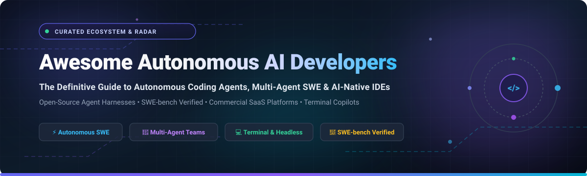
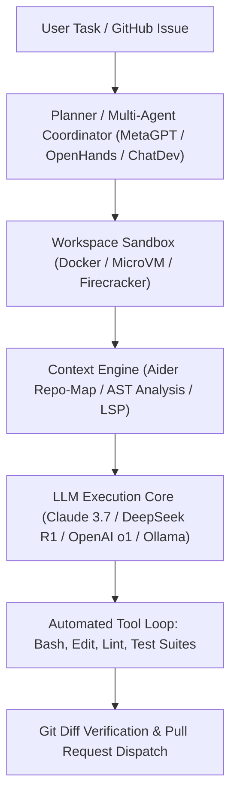

# 🤖 Awesome Autonomous AI Developers 🚀

  

  
  
  
  
  
  
  

---

## 🌟 Top Autonomous AI Developers Ecosystem

> ⚡ **A curated directory of production-ready SaaS platforms & open-source AI software engineering agents.**  
> *Specializing in autonomous full-codebase generation, multi-file editing, SWE-bench problem solving, and headless terminal copilots.*  
> 📅 **Last updated: October 2026**

This repository comprehensively tracks the ecosystem of **Autonomous AI Software Engineers and Coding Agents**. These autonomous agents and agentic IDEs empower developers, DevOps engineers, and platform teams to delegate end-to-end software development workflows—including GitHub issue diagnosis, architectural planning, multi-file code refactoring, automated testing, terminal execution, and pull request generation—without file-by-file manual intervention.

---

## 📑 Table of Contents

- [📊 Sector Overview & Market Dynamics](#-sector-overview--market-dynamics)
- [☁️ SaaS / Hosted Platforms](#️-saas--hosted-platforms)
- [💻 Open-Source GitHub Projects](#-open-source-github-projects)
- [🛠️ Architecture & Custom Framework Stacks](#️-architecture--custom-framework-stacks)
- [🤝 How to Contribute](#-how-to-contribute)
- [💖 Support & Sponsorship](#-support--sponsorship)
- [📈 Star History](#-star-history)
- [⚠️ Disclaimer & Security Boundary](#️-disclaimer--security-boundary)

---

## 📊 Sector Overview & Market Dynamics

The global market size for AI developer tools and autonomous coding agents reached an estimated **$7.5 billion in 2025–2026** and is projected to expand at a compound annual growth rate (CAGR) exceeding **28% through 2032**. 

The sector exhibits **moderate fragmentation with aggressive power-law concentration dynamics**: foundational cloud infrastructure leaders (Microsoft Copilot and AWS Amazon Q) hold broad enterprise distribution advantages, while specialized high-velocity agent pioneers (Cursor, Cognition/Windsurf, and Replit) capture concentrated developer mindshare and valuation premiums, coexisting alongside an exceptionally vibrant, defensive open-source agent ecosystem (OpenHands, Cline, Goose, and Aider) resisting single-vendor lock-in.

---

## ☁️ SaaS / Hosted Platforms

| Product | Company Size (Valuation / Revenue) | Pricing (Starting Paid Tier) | Free Tier Limits | Description |
|---|---|---|---|---|
| **[GitHub Copilot](https://github.com/features/copilot)** | ~$4.0T Market Cap (Microsoft) / $331.8B Rev | $10/user/mo ($100/yr) for Copilot Individual | 2,000 code completions/month, 50 chat messages/month with light models | **The most widely adopted AI coding assistant** with code completion, chat, and **Copilot Workspace** for multi-file task planning. **Coding agent dispatches from issue assignment**—posts 👀 reaction, exposes PR checklist with live session logs. |
| **[Amazon Q Developer](https://aws.amazon.com/q/developer/)** | ~$2.74T Market Cap (Amazon) / $776B Rev | $19/user/mo for Pro tier | 50 agentic requests/month, 1,000 lines of code transformation/month, 50 security scans/month | **AWS's AI coding companion** with code generation, security scanning, and AWS service integration. **The most integrated with AWS ecosystem**. |
| **[Cursor](https://cursor.com/)** | $60B Valuation (Anysphere) / ~$2B+ ARR | $20/mo for Pro tier | 2,000 completions/month, 50 slow premium requests/month, plus 14-day Pro trial | **AI-first code editor** built on VS Code with **Composer** for multi-file editing and **Agent mode** for autonomous task execution. **The most popular AI-native IDE** for professional developers. |
| **[Windsurf](https://windsurf.com/)** | $48B Valuation (Cognition) / ~$900M ARR | $15/user/mo for Pro tier | Unlimited tab autocomplete and inline edits; capped at 25 Cascade agent flow actions/month | **Agentic IDE** with **Cascade** for multi-step task execution. Acquired by Cognition (makers of Devin) in 2025. |
| **[Replit AI](https://replit.com/)** | $9B Valuation (Replit) / ~$300M ARR | $20/mo ($18/mo billed annually) for Core plan | Limited daily AI agent trial credits, 1 published app, 1 vCPU, 2 GiB RAM, 1,200 dev hrs/month | **Browser-based AI coding environment** with **Ghostwriter** for code generation and **Agent** for autonomous task execution. **The most accessible zero-setup option**. |
| **[Sourcegraph Cody](https://sourcegraph.com/cody)** | $2.6B Valuation (Sourcegraph) / ~$50M ARR | $9/user/mo for Pro tier (Enterprise starting at $19/user/mo) | 200 chat and command queries/month, unlimited autocomplete completions | **AI coding assistant with codebase-wide context**—answers questions about your entire repository, not just open files. |
| **[Codeium](https://codeium.com/)** | $1.25B Valuation (Exafunction) / ~$80M ARR | $15/user/mo for Pro tier | Unlimited fast autocomplete completions, unlimited chat queries, across 70+ languages | **Free AI coding assistant** with autocomplete, chat, and search across 70+ languages. **The most generous free tier** in the category. |
| **[Tabnine](https://www.tabnine.com/)** | ~$60M Total Funding / ~$30M ARR | $39/user/mo (billed annually) for Code Assistant | 14-day free trial of Pro tier with unlimited completions and chat; basic short-form completions on dev preview | **AI code assistant with enterprise security**—runs locally or in your VPC, never trains on your code. **The most privacy-focused commercial option**. |
| **[Supermaven](https://supermaven.com/)** | $12M Raised (Acquired by Cursor/Anysphere) | $10/mo for Pro tier | Unlimited fast code completions with 300,000 token context window, 7-day data retention | **Ultra-fast code completion** with **1 million token context window**. **The fastest autocomplete** in the category. |
| **[Continue](https://continue.dev/)** | $5.6M Raised (Acquired by Cursor/Anysphere) | 100% Free / Bring Your Own Model ($0 platform fee; pay LLM provider per token) | Free forever (100% open-source Apache 2.0 with unlimited local model inference via Ollama/LM Studio) | **Open-source IDE extension** with chat, autocomplete, and edit modes. **The most popular open-source Copilot alternative** for VS Code and JetBrains. |

---

## 💻 Open-Source GitHub Projects

*Sorted in descending order by GitHub Stars ⭐.*

1. **[OpenHands](https://github.com/All-Hands-AI/OpenHands)**   
   **Open platform for AI software developers as generalist agents** (MIT) • **91,000+ stars** 🌟  
   OpenHands agents can do anything a human developer can: modify code, execute bash commands, navigate browser interfaces, invoke APIs, and manage complete multi-turn developer lifecycles. Offers three modular interfaces: an extensible **Python SDK**, a headless **CLI**, and a polished **Local Web GUI**. Employs **CodeAct 2.1 architecture** with sandboxed container execution, scoring **53% on SWE-bench Verified**.

2. **[MetaGPT](https://github.com/geekan/MetaGPT)**   
   **Multi-agent collaborative framework returning PRDs, System Designs, and Code** (MIT) • **70,800+ stars** 🌟  
   Assigns distinct specialized roles to LLMs—including Product Managers, Architects, Project Managers, and Engineers. Enforces standard operating procedures (SOPs) based on the philosophy **Code = SOP(Team)**, delivering an entire simulated software development company lifecycle from prompt to deployment.

3. **[Cline](https://github.com/cline/cline)**   
   **Autonomous coding agent extension inside VS Code & terminal** (Apache-2.0) • **70,300+ stars** 🌟  
   Equipped with human-in-the-loop permission checkpoints to edit files, inspect project trees, execute shell commands, read browser consoles, and interface with external tools via Model Context Protocol (MCP). Brings frontier reasoning models directly into local developer environments.

4. **[Goose](https://github.com/block/goose)**   
   **Open-source on-machine autonomous AI agent from Block** (Apache-2.0) • **55,300+ stars** 🌟  
   An extensible desktop and terminal agent built for local and cloud developers. Capable of installing toolkits, writing and debugging complex applications, automating scripting tasks, and extending capabilities through native MCP tool integration.

5. **[GPT-Engineer](https://github.com/antonosika/gpt-engineer)**   
   **Specify what you want to build, clarify ambiguities, and generate full codebases** (MIT) • **55,000+ stars** 🌟  
   The pioneer of natural language full-codebase generation. Accepts human language specification prompts, clarifies functional requirements, and generates complete multi-file repositories. *(Note: Reference release; commercial counterpart evolved into Lovable).*

6. **[Aider](https://github.com/aider-ai/aider)**   
   **AI pair programming in your terminal** (Apache-2.0) • **49,500+ stars** 🌟  
   The reference standard for terminal-based interactive and headless AI coding. Automatically maps complete project repositories into token-efficient context graphs, performs multi-file edits, runs automated linter & test suites, and crafts clean, structured Git commit messages upon task verification. Compatible with Claude 3.7 Sonnet, DeepSeek R1, OpenAI o1, and local LLMs.

7. **[Continue](https://github.com/continuedev/continue)**   
   **Open-source modular AI code assistant & Copilot alternative** (Apache-2.0) • **36,200+ stars** 🌟  
   Extensible IDE assistant for VS Code and JetBrains enabling autocomplete, inline code refactoring, context-aware repository chat, and custom provider backends (Ollama, vLLM, LM Studio, Anthropic, OpenAI).

8. **[ChatDev](https://github.com/OpenBMB/ChatDev)**   
   **Virtual software company powered by communicative multi-agent systems** (Apache-2.0) • **34,500+ stars** 🌟  
   Multi-agent conversational framework orchestrating simulated employees (designers, programmers, testers, reviewers) in structured dialogue to collaboratively write, test, and document complete multi-file software applications.

9. **[SWE-agent](https://github.com/SWE-agent/SWE-agent)**   
   **Autonomous agent for GitHub issue resolution from Princeton & Stanford** (MIT) • **20,500+ stars** 🌟  
   Turns language models into autonomous software engineers that resolve GitHub issues automatically. Clones repositories, audits issues, navigates directories, modifies files, validates unit tests, and formats clean pull request patches.

10. **[Devika](https://github.com/stitionai/devika)**   
    **Agentic AI Software Engineer & Devin Alternative** (MIT) • **19,500+ stars** 🌟  
    Interprets natural language engineering prompts, breaks them down into hierarchical subtasks, conducts automated web research, browses live web applications, and writes code across languages using local or proprietary models.

11. **[Plandex](https://github.com/plandex-ai/plandex)**   
    **Terminal-based AI coding engine for complex, multi-stage development** (AGPL-3.0) • **15,700+ stars** 🌟  
    Engineered for large, multi-file code modifications with branch-like sandboxed environments, Git diff previews, architectural planning phases, and granular rollback controls.

12. **[Sweep](https://github.com/sweepai/sweep)**   
    **AI junior developer that turns GitHub issues into ready-to-merge PRs** (Apache-2.0) • **7,700+ stars** 🌟  
    Monitors GitHub issue queues, understands requirements, writes code and test suites, responds to review comments, and opens clean pull requests autonomously.

13. **[AutoDev](https://github.com/unit-mesh/auto-dev)**   
    **Autonomous AI coding engine with multilingual enterprise support** (MIT) • **4,500+ stars** 🌟  
    Supports Java, Kotlin, TypeScript, Rust, Python, and Go, interfacing directly with test execution runtimes and language server protocol (LSP) analyzers.

14. **[Devon](https://github.com/entropy-research/devon)**   
    **Autonomous software engineer agent with multi-file reasoning** (MIT) • **3,400+ stars** 🌟  
    Equipped with rigorous code navigation and editing toolkits for resolving complex engineering problems without breaking existing dependencies.

15. **[GPTScript](https://github.com/gptscript-ai/gptscript)**   
    **Natural language scripting framework for building autonomous agents** (Apache-2.0) • **3,200+ stars** 🌟  
    A specialized prompt scripting runtime created by Acorn Labs that allows language models to cleanly call tools, invoke binaries, and automate CLI workflows.

16. **[AutoCodeRover](https://github.com/nus-apr/auto-code-rover)**   
    **Automated program repair & structural code search agent** (MIT) • **3,100+ stars** 🌟  
    Combines abstract syntax tree (AST) code navigation with statistical fault localization algorithms to detect and autonomously repair software defects.

17. **[Codel](https://github.com/semanser/codel)**   
    **Fully autonomous AI developer operating within Docker sandboxes** (Apache-2.0) • **2,400+ stars** 🌟  
    Binds terminal execution, file system modifications, and browser interactions inside secure Docker containers with full PostgreSQL session histories.

---

## 🛠️ Architecture & Custom Framework Stacks

For organizations and engineering teams assembling a fully self-hosted, private autonomous software engineering platform:

- **Issue Resolution Engine**: Combine **OpenHands** or **SWE-agent** for automated ticket handling.
- **Terminal Pair Programming**: Deploy **Aider** or **Cline** for daily developer terminal workflows.
- **Team-Scale Multi-Agent Simulation**: Leverage **MetaGPT** or **ChatDev** to generate architecture designs, PRDs, and component scaffolds.

---

## 🤝 How to Contribute

Contributions to keep this ecosystem accurate and comprehensive are welcome! 🚀

1. 🍴 **Fork** the repository.
2. 🌿 Create your feature branch (`git checkout -b feature/add-new-agent`).
3. 📝 Add your entry into `README.md` adhering to the table or open-source list format (include official links, license, and factual summaries).
4. ⭐ Ensure star counts or pricing specifics are accurate.
5. 🚀 Submit a descriptive **Pull Request**.

---

## 💖 Support & Sponsorship

If this curated repository saves you research hours or helps you discover game-changing autonomous developer tools, please consider supporting the project:

- ⭐ **Star this repository** to help others discover it.
- 🍴 **Fork & Share** with your developer community, platform engineering team, and AI enthusiasts.
- ☕ **Buy a Coffee & Sponsor:** Show your appreciation and fuel ongoing updates via the [GitHub Sponsors Dashboard](https://github.com/sponsors/ishandutta2007).

Thank you for being part of the open autonomous AI developer revolution! 🙌

---

## 📈 Star History

---

## ⚠️ Disclaimer & Security Boundary

- 🔍 **Community Curated**: This repository serves as an independent index and technical reference. Inclusion does not imply official commercial affiliation or endorsement.
- 🛡️ **Sandbox Security**: Autonomous agents execute terminal commands, install packages, and edit directory trees. **Always execute autonomous coding agents inside sandboxed environments (Docker, isolated containers, or microVMs)**. Never grant agents unfettered write access to production infrastructure or secrets.
- 💰 **Token Consumption**: Multi-agent loops and full-context repo-maps consume significant token volumes. Set automated budget alerts and spending limits when pairing with frontier cloud APIs.

---

  <b>Built with ❤️ for developers, platform teams, and AI architects worldwide.</b> 
  Let's build autonomous, open-source, and verifiable software engineering together.

